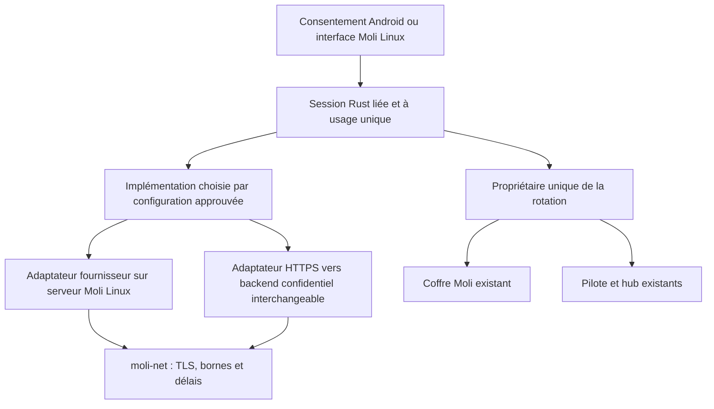

# OAuth commun Rust : proposition de séparation

Proposition du 25 octobre 2026, fondée sur le code Android `f4f9164`.
**Livré ici : comparaison et contrats proposés, sans changement d'exécution.**
Les noms d'API ci-dessous ne désignent pas des API déjà disponibles.

## Comparaison des quatre références

Les liens sont figés sur les révisions lues ; leur présence ne prouve aucune
qualification fournisseur dans ce fork.

| Référence | Commun réutilisable | Spécificités à garder dans l'intégration |
| --- | --- | --- |
| [Moli amont / Alexa, `44cd9e2`](https://github.com/rudy-io/moli-os/blob/44cd9e2e29dd7dcdb41d69d290e08cc48472e615/crates/moli-alexa/src/auth.rs) | Aléa système, défi S256 conforme au vecteur RFC 7636, navigateur, échange et renouvellement, Debug partiellement masqué, transport `moli-net`. | `device:<client_id>` dérivé du numéro de série, paramètres OpenID Amazon, `/auth/register`, identité d'application Alexa, puis refresh → cookies → CSRF. Ce parcours ne constitue pas la preuve d'un client public PKCE officiel pour d'autres fournisseurs. Pas de couple OAuth access/refresh standard persistant. |
| [Nicky / météo, `a835893`](https://github.com/essaddam/nicky-os/blob/a83589366f67d6b8273a10ad41658d688e498fda/crates/moli-netatmo/src/oauth.rs) | `Pending` avec empreinte du state, liaison de session, échéance monotone et consommation unique ; `TokenSet` complet, Debug masqué, validation bornée, persistance avant usage. | `read_station` seul ; durée de consentement 10 minutes ; liaison à la session PIN exacte ; enveloppe `version: 1` dans `oauth_tokens`. Les [routes](https://github.com/essaddam/nicky-os/blob/a83589366f67d6b8273a10ad41658d688e498fda/crates/moli-api/src/netatmo.rs) vérifient origine et session ; GET statique puis POST de même origine, sans écho du code. Ce n'est pas Netatmo Energy. |
| [Brizgir / Energy, `4825e54`](https://github.com/Brizgir/moli-os/blob/4825e545baaada90f0d78fcd940637011025ed46/crates/moli-netatmo/src/auth.rs) | Authorization Code, formulaires de token/refresh, secret dans le coffre serveur ; distinction réautorisation, application invalide, quota. | `read_thermostat write_thermostat` ; recopie d'URL ou code nu. `code_of` n'exige pas le state absent ni l'origine exacte et accepte un code seul : ne pas reprendre ce contrat de callback. La [persistance](https://github.com/Brizgir/moli-os/blob/4825e545baaada90f0d78fcd940637011025ed46/crates/moli-netatmo/src/lib.rs) garde le refresh token, pas une paire access/refresh atomique. Le parseur tolère un refresh absent et une durée par défaut. |
| [Ce fork / Android Energy, `f4f9164`](https://github.com/torshu-hub/moli-os-android/blob/f4f9164f7411fe13f7725aa3cb3c8e279d5cdc3a/crates/moli-netatmo/src/oauth/mod.rs) | `Broker`, `Client`, session mémoire bornée, callback exact à usage unique, `Grant` masqué ; paire atomique dans le coffre existant ; séparation serveur/Android. | `read_thermostat` seul ; session 5 minutes et preuve de remise Moli en SHA-256 hexadécimal, **pas du PKCE Netatmo**. `Policy`, `Grant` et erreurs sont encore Netatmo. Seul `Unconfigured` est branché en production. Échange/refresh confidentiels exclus d'Android ; renouvellement Android absent. |

La [documentation Nicky](https://github.com/essaddam/nicky-os/blob/a83589366f67d6b8273a10ad41658d688e498fda/integrations/netatmo/README.md)
décrit un acteur supervisé unique, une file bornée et l'absence de rejeu après
envoi ambigu d'un renouvellement. C'est un modèle utile de propriété des jetons.
La [documentation Brizgir](https://github.com/Brizgir/moli-os/blob/4825e545baaada90f0d78fcd940637011025ed46/integrations/netatmo/README.md)
décrit un serveur autonome avec clés propres et recopie manuelle, pas un service
OAuth commun prêt pour mobile. Ses commandes de chauffage restent hors périmètre.

Le parseur de retour Alexa accepte notamment un préfixe `www.amazon.` ; il ne
constitue pas un validateur commun d'origine exacte. `SignIn` ne porte pas de
state ni d'échéance dans ce fichier. Extraire S256 ne dispense donc pas de définir
la corrélation et la durée du parcours propre à Amazon.

## Ce que le modèle Home Assistant apporte

À la révision `944750c`,
[`application_credentials`](https://github.com/home-assistant/core/blob/944750cefec1cd78fdd4817eb5f6fb6782e172ea/homeassistant/components/application_credentials/__init__.py)
sépare les applications enregistrées, les endpoints fournisseur et les
implémentations sélectionnables. Une entrée d'intégration référence son
`auth_implementation` ; supprimer une application encore utilisée est refusé.
[`config_entry_oauth2_flow`](https://github.com/home-assistant/core/blob/944750cefec1cd78fdd4817eb5f6fb6782e172ea/homeassistant/helpers/config_entry_oauth2_flow.py)
sépare génération du consentement, résolution du retour, renouvellement et
session d'accès, avec verrou de renouvellement. Une implémentation PKCE distincte
ajoute verifier/challenge ; un fournisseur peut personnaliser l'implémentation.

Reprendre ces responsabilités et cette sélection explicite. Garder le coffre
chiffré Moli, ses formats et les limites de transport ; ne pas recopier le
stockage Python, les dictionnaires de tokens, les logs de réponses, le routage
My Home Assistant ou une dépendance à un service central. PKCE et secret client
sont deux propriétés distinctes : un client confidentiel peut aussi utiliser PKCE.

## Architecture cible minimale

Une future crate `moli-oauth` est justifiée seulement lors d'une extraction
consommée par deux parcours. Elle contiendrait les valeurs et transitions communes,
sans JNI, routes HTTP, coffre, moteur de pilotes ou tâche permanente. Les politiques
fournisseurs restent dans les crates d'intégration. Les adaptateurs réutilisent
`moli-net`, le superviseur et les points d'injection des transports de test ;
aucun second client HTTP, aucun second coffre global. Meross local reste indépendant.

| Contrat proposé | Responsabilité et borne |
| --- | --- |
| `ProviderPolicy` | Identifiant fournisseur, endpoints validés, scopes permis, authentification client (`public` ou `confidential`), capacité PKCE, limites et règles de réponse. Aucune découverte d'URL fournie par callback, formulaire ou LLM. Les extensions Amazon sont typées par son adaptateur. |
| `ApplicationRef` / `ImplementationId` | Référence stable d'application et de son mode d'exécution, révision du client/redirect ; secret résolu uniquement par l'adaptateur confidentiel depuis son coffre. Plusieurs instances peuvent référencer une application sans partager leurs tokens. Refuser sa suppression tant qu'elle est utilisée. |
| `FlowBinding` | Liaison à l'installation/génération de données, fournisseur, implémentation/application, instance, emplacement de compte et session humaine ou appareil authentifié. L'emplacement est un ID opaque local, jamais une adresse e-mail ou le nom affiché. La liaison est contrôlée côté serveur, pas déclarée par le seul mobile. |
| `PendingConsent` | State imprévisible, secret masqué, échéances UTC et monotone, redirect enregistré immuable, liaison, consommation unique et annulation. Refus fournisseur corrélé avant consommation ; doublons, retour sans state, autre origine, expiration et rejeu refusés. Aucun code nu comme remplacement implicite du callback validé. |
| `AuthorizationImplementation` | Opérations `begin(binding)`, `complete(flow, retour_validé)` et `refresh(credential)` ; progression asynchrone facultative pour le broker. Les entrées/sorties sensibles sont opaques et masquées, pas des JSON publics. Les méthodes locales n'imposent pas le polling du broker. |
| `CredentialOwner` | Un seul propriétaire par credential, qui sérialise résolution, refresh, sauvegarde et oubli. Une instance partageant explicitement un compte utilise le même propriétaire ; sinon elle a son propre credential. Une déconnexion invalide les travaux en vol avant toute sauvegarde tardive. |
| `CredentialStore` | Port interne `load`, `commit_complete`, `forget`, implémenté par `DriverCtx`/coffre ou la file `EngineHost` existants. Le commit porte la génération attendue et ne devient visible qu'après succès durable. Cette vérification de génération reste à réaliser ; le coffre actuel n'est pas un CAS distribué. |

`Credential` ne doit pas imposer une paire access/refresh à Alexa : prévoir un
matériel typé par l'implémentation (paire OAuth standard, ou credential Amazon
opaque avec serial). L'enveloppe commune porte les références et la génération ;
le codec du fournisseur préserve le format existant. Le PKCE RFC 7636 S256 utilise
base64url sans padding ; ne pas le confondre avec la preuve hexadécimale de remise
déjà utilisée par `Broker`.

## Rotation, erreurs et isolation

Pour Netatmo, une réponse valide produit **un seul couple complet** access/refresh
avec expiration et scopes validés. Le pilote attend la sauvegarde avant toute
lecture avec ce couple. En cas d'échec, il conserve le couple en attente et retente
son écriture ; il ne relance pas un refresh de l'ancien token. Une politique peut
autoriser l'ancien refresh lorsque le fournisseur documente son omission ; ce
n'est pas une tolérance globale et Netatmo conserve ici son exigence de paire.

Le propriétaire doit garder un verrou logique de génération couvrant échange et
commit, sans bloquer les mutex du hub pendant le réseau. Après annulation/oubli ou
restauration, un résultat d'une ancienne génération ne peut réinsérer un credential.
Un backend partagé exige la même propriété durable (transaction ou lease et
génération) entre processus ; un simple mutex mobile ne suffit pas.

Les erreurs communes sont des catégories sans texte distant : configuration,
refus, réautorisation, application refusée, quota avec délai borné, réseau avant
envoi, résultat d'envoi ambigu, réponse invalide, stockage. Ne pas réessayer
automatiquement un code ou refresh potentiellement consommé. Le backend conserve
une rotation validée avant remise ; un identifiant de transaction authentifié
permet de récupérer **le même résultat** après perte d'accusé. Si l'issue est
inconnue, demander une réautorisation plutôt que rejouer à l'aveugle.

Garder séparés statut de consentement, présence locale des credentials,
fonctionnement de l'accès API et fraîcheur des observations. Oublier localement
n'est pas révoquer chez le fournisseur. La révocation distante n'est disponible
que si elle est documentée et explicitement demandée ; sinon indiquer la démarche
manuelle. Ni token, code, state, verifier, cookie, URL sensible ou corps d'erreur
ne passe dans les diagnostics publics.

Les namespaces actuels du coffre isolent les instances. Pour plusieurs comptes,
prévoir des références opaques stables et une association explicite ; ne pas
renommer les instances ou réécrire les clés historiques pour installer cette
architecture. Une application commune ne vaut pas partage de consentement.

## Adaptateurs et déploiements Netatmo

La [documentation officielle](https://dev.netatmo.com/apidocumentation/oauth),
revérifiée le 25 octobre 2026 via son contenu public
`POST /api/getwysiwyglayoutjson` (`file=connect/apidocumentation/oauth/file.json`),
exige le secret côté serveur et exclut son exposition dans les applications mobiles.
Elle ne documente ni PKCE ni un client public natif sans secret. Ce constat
n'établit pas l'inexistence d'une offre différente : confirmation officielle requise.

| Déploiement | Conséquence |
| --- | --- |
| Moli Linux confidentiel, navigateur Android ou Linux | Application/secret dans le coffre du serveur ; callback à ajouter au routeur `moli-api` existant avec origine enregistrée, TLS et authentification appropriés. Le serveur échange et renouvelle. Le téléphone peut être un client de cette instance ; ce n'est alors plus le moteur Android autonome. |
| Moteur Android autonome et backend confidentiel HTTPS | Backend choisi et autorisé séparément, propriétaire de l'application/secret, transactions et rotations durables ; appairage/authentification de l'appareil et liaison au compte obligatoires. Aucun prestataire, domaine ou hébergement imposé. Un serveur Moli Linux contrôlé peut remplir ce rôle. |
| Android seul, sans backend | Netatmo ne peut pas être activé sur la seule base du protocole actuellement documenté. Une abstraction Rust ou le Keystore ne rendent pas confidentiel un secret applicatif distribué dans l'APK. |

Pour le backend, conserver d'abord le mode de remise déjà prévu : paire complète
vers le coffre Android, puis renouvellement par ce même backend confidentiel.
Il faut spécifier les acquittements, récupération de résultat et invalidation de
génération avant de généraliser `Broker`. Une variante où tous les tokens restent
au serveur et le mobile ne reçoit qu'un handle est un autre contrat d'accès aux
données ; ne pas l'introduire comme simple changement de type de `Grant`.

## Réutilisation et ordre de réalisation

1. **Ce jalon : proposition seulement.** Le port `Broker` ne gère pas encore le
   renouvellement ; les autres références n'ont ni la même propriété de tokens,
   ni les mêmes codecs, ni le même parcours de retour. Extraire ce port maintenant
   imposerait à tous le polling et la paire Netatmo, sans deuxième consommateur
   réel. Ajouter une crate inutilisée ne démontrerait pas la mutualisation.
2. **Premier incrément de code proposé, sans hébergement :** préciser puis extraire
   uniquement `PendingConsent` et sa liaison/consommation, avec un adaptateur de
   compatibilité autour de `CallbackSession` Netatmo et un deuxième parcours basé
   sur le vrai `Pending` Nicky (`read_station`, session PIN). Conserver leurs
   politiques distinctes de 5/10 minutes et leurs transports. Tester les deux
   codecs/liaisons avec entrées synthétiques ; ne pas importer tout le pilote météo.
   Si l'adaptateur Nicky ne peut pas consommer cette primitive sans changer son
   contrat, différer la crate plutôt que livrer un exemple fictif.
3. **Ensuite :** port de rotation et persistance avec génération, d'abord Netatmo
   serveur et Nicky ; garder `oauth_tokens` Energy inchangé, enveloppe Nicky
   versionnée inchangée. Alexa ne consomme que les primitives adaptées à son
   protocole ; cookies, enregistrement et CSRF restent à part. Pas de migration
   cassante des credentials Alexa `refresh_token`/serial.
4. **Après choix du déploiement :** implémenter le transport confidentiel authentifié,
   stockage durable des transactions, récupération après crash, renouvellement
   Android et sélection non destructive de la maison. Puis seulement connexion
   réelle avec consentement distinct, `read_thermostat` seul.
5. Après tests et revue dans deux parcours, proposer éventuellement la brique
   réutilisable à l'amont Apache-2.0, avec provenance/licences vérifiées si du code
   externe est repris. Aucune PR amont automatique ni synchronisation générale.

Les tests du futur incrément doivent exercer deux instances/comptes simultanés,
state/liaison croisés, refus sans state, limite d'expiration, double consommation,
annulation pendant échange, panne de sauvegarde et reprise, perte d'accusé après
rotation, ancienne génération après restauration, Debug masqué et conservation
exacte des autres secrets/configurations. Un check Android avec la feature serveur
doit confirmer son exclusion. Aucun compte, appareil ou APK n'est nécessaire.

Pour ce changement documentaire : contrôle des liens locaux et des références
figées, diff sans source/configuration, contrôle de fuites et sélection CI. Les
campagnes Rust, JVM, émulateur et livraison ne sont pas relancées à code inchangé.
